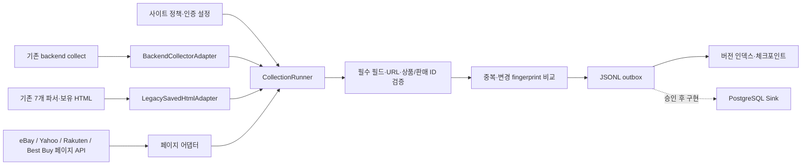

# 공통 수집 아키텍처

2026-11-08. 기준 브랜치 `laptop-work-backup`, 백업 커밋 `2da44c7`. 기존 샘플·설정·수집기를 보존하며 DB에 연결하지 않는 실행 계층을 추가했다. `research_domestic/`는 변경하지 않는다.

## 구현된 경계



`Adapter.fetch_page(query, cursor, limit, since) → Page[Offer]`가 공통 실행 계약이다. `Offer`는 기존 `backend.models.Product`와 공급자 상품 ID·판매 ID를 묶는다. DB 모델 변경 없이 출처·동일성·관측 이벤트를 별도 envelope에 담는다.

| 연결 | 구현 | 실제 실행 범위 |
|---|---|---|
| 기존 backend 수집기 | `BackendCollectorAdapter`가 기존 `collect()`를 호출 | 페이지 기능이 없는 수집기에 가짜 offset을 부여하지 않음. Apple은 원본 trackId 사용, 다른 수집기는 URL 해시 fallback 명시 |
| 기존 crawler_engine 7개 | `LegacySavedHtmlAdapter`가 기존 추출·집계·정규화를 재사용 | 제공된 보유 HTML만 처리. 브라우저·내부 API·상세 요청 자동 실행 없음. 11번가 공식 XML API와 legacy 내부 요청을 구분 |
| eBay | `EbayPagedAdapter` | 기존 OAuth와 `_to_product` 재사용, offset·itemId·marketplace 포함 판매 ID, 한 인스턴스에서 토큰 메모리 재사용 |
| Yahoo / Rakuten / Best Buy | 신규 `official_catalogs.py`의 3개 수집기 및 `PagedCollectorAdapter` | 키 미설정, 실응답 미검증. 단일 요청 1~3개, 공식 페이지 범위 제약. backend 서버의 `/sources`에 추가하지 않았으며 공통 엔진 registry에서 사용 |

Registry는 기존 backend 수집기를 생성할 수 있고, 보유 HTML 경로를 명시하면 legacy 어댑터를 생성한다. 정책은 `source_policies.json`에서 별도로 차단한다. legacy 소스의 live 권한을 자동 승인하지 않으므로 HTML 보유·처리 권한을 검토한 뒤 독립적인 로컬 파싱 용도로 사용해야 한다.

## 권한과 저장

`SourcePolicy`는 수집 방식, 조회 허용, 인증 환경변수 이름, 목적, 검증 건수 제한, 보존 시간, 대량 승인, 생략 필드를 분리한다. 현재 모든 실제 소스의 `bulk_approved=false`이며 기본 검증 최대 3개다. eBay·Apple·YES24 외 추가 소스는 조회 정책 재검토 전 기본 차단한다. 키 존재만으로 차단을 해제하지 않는다. URL·약관 링크가 있다는 사실은 허용 증명이 아니다.

기본 3,600초는 **프로젝트 내부의 짧은 검증 캐시 한도**로, 공급자가 영구 저장이나 1시간 저장을 일괄 허용했다는 의미가 아니다. 각 약관과 실제 승인 목적을 우선 적용한다. envelope에 `expires_at`, `policy_reference`, `purpose`를 기록하고 만료 데이터는 outbox reader에서 제외한다. 기존·신규 증거 파일의 물리 삭제는 이 세션에서 실행하지 않았다. 운영 도입 전 공급자별 계약에 따른 파기·보존 작업을 승인받아 연결해야 한다. 데이터 조회 성공 2개가 영구 300만 건 축적 권한을 뜻하지 않는다.

정규화 전후에 없는 필드는 null이며 seller를 저자·쇼핑몰 이름으로 추정하지 않는다. 정책상 seller·region·description을 기본 생략하고 Apple은 image_url도 생략한다. `missing_field_rates`는 이 생략 전 입력 Product의 누락률이므로 내보내기 결과의 null 비율과 다를 수 있다. 의도적인 생략은 정책 파일과 함께 해석한다.

## 중복·증분·품질

- `offer_key = SHA256(source, product_id, offer_id, currency)`. 상품 ID만으로 다른 판매 조건을 합치지 않는다. 공급자 판매 ID가 없으면 URL 해시 fallback을 명시하며 query를 임의 제거하지 않는다. 국내 legacy 추출 결과에 공급자 ID가 없다는 한계는 남아 있다.
- 동일 페이지의 같은 판매 키는 첫 항목을 유지하고 duplicate로 센다. 서로 다른 가격이 같은 키로 온 경우의 공급자별 우선순위는 추가 설계 대상이다.
- 가격·URL·카테고리 등 보존 허용 필드의 fingerprint가 같으면 unchanged로 생략하고, 가격 등 내용이 달라지면 새 이벤트를 출력한다. 관측 시각과 로컬 DB id는 fingerprint에서 제외한다.
- 새 job_id로 재조회하면 기존 버전 인덱스를 사용한다. 같은 job_id는 동일 실행 재개다. 변경 없는 관측은 버전의 TTL을 연장하지 않으므로 기존 캐시가 만료된 뒤 다시 출력할 수 있다. 매 조회마다 last_seen을 갱신하는 heartbeat는 아직 구현하지 않았다.
- provider의 공식 updated-since 지원이 없는 검색 API에는 `since`를 보내지 않고 `server_incremental_not_supported`로 거부한다. 현재 증분은 재조회 후 클라이언트 내용 비교다. offset 검색 결과는 snapshot이 아니므로 검색 순위 변화에 따른 누락 가능성이 있다. 완전한 전수 수집·삭제 감지는 보장하지 않는다.
- 공백 상품명·ID 누락·가격 누락/음수/비유한 값·통화 형식·상품/이미지 URL을 검증한다. 사설 IP·localhost·URL 내 사용자 인증정보·비HTTP 스킴은 거부한다. 도메인 DNS 재해석·실상품 페이지 GET 검증은 하지 않으므로 SSRF 방어용 범용 fetcher로 사용해서는 안 된다.
- 입력 건수, 페이지, invalid, duplicate, unchanged, emitted, 누락률, 원인 코드를 실행 결과에 기록한다. 0개를 정상 종료한 실행은 실제 연동 성공으로 계산하지 않는다.

## 오류와 재개

HTTP는 단일 transport 인스턴스에서 순차 실행하며 기본 최소 3.1초, 최대 3회 시도다. timeout/연결 오류 및 429/일부 5xx만 지수 백오프와 jitter로 재시도한다. `Retry-After`가 최대 대기 30초보다 길면 짧게 잘라 재시도하지 않고 중단·기록한다. 401·403·리다이렉트는 재시도하지 않는다. 인증 헤더·토큰·요청 URL·응답 본문을 오류 문자열에 넣지 않는다. Apple은 기존 robots 확인을 유지하며 eBay OAuth 실패는 별도로 분류한다.

정상 페이지는 **outbox 저장 → 버전 인덱스 저장 → 체크포인트 저장** 순서다. 출력 실패 시 cursor를 진행하지 않는다. 출력 후 체크포인트 전 장애는 중복 재전달할 수 있어 delivery 의미는 **at-least-once**다. event_id는 job/page/판매 키/내용으로 결정되므로 소비자는 event_id를 idempotency key로 사용한다. 부분 버전 저장 후 재시도하면 다른 outbox 배치에도 같은 event_id가 있을 수 있다. 파일 개수를 실상품 수로 세면 안 된다.

로컬 상태는 해시 접두사 3자리로 버전 인덱스를 분할하며 전체 상품을 한 번에 메모리에 올리지 않는다. OS 파일 잠금은 프로세스 종료 시 해제되므로 lock 파일을 삭제하지 않고 재개할 수 있다. 단일 상태 디렉터리에는 writer 1개만 허용한다. 파일 flush/fsync와 원자적 replace를 사용하지만 전원 장애·네트워크 파일시스템·분산 exactly-once를 검증한 구현은 아니다.

## 300만 건으로 확장할 때

현재 구현은 로컬 참조 엔진이다. 100개 실제 연동, 300만 건 처리 검증이 완료된 제품이라고 보고하지 않는다. 소량 합성 측정은 별도 JSON에 `synthetic=true`, `real_product_count=0`으로 기록했다.

운영 전 DB 담당자와 `StateStore`/`Sink` 계약을 구현하고, source·marketplace·query/feed partition별 작업 큐와 공용 quota 관리, 임대/heartbeat, sink commit과 checkpoint의 일관성, TTL 파기, 모니터링을 연결한다. 상품 검색 API를 무리하게 페이지 순회하기보다 승인된 feed/snapshot과 제공자 공식 변경 피드를 우선 사용한다. 공급자 승인 없이 기본 3개 상한을 올리지 않는다.

예를 들어 300만 판매 행을 500개 묶음으로 전달하면 6,000배치다. 이는 배치 수 산술이며 공급자 API 호출량·처리 시간 예측이 아니다. PostgreSQL에서는 source/offer identity 및 event_id 인덱스, 수집 실행·현재 판매·이력·소스 권한 테이블의 역할을 분리하되 실제 DDL은 소병선 팀원과 합의 후 적용한다.

## 실행

```powershell
python -m collection_engine --live --source apple_books_lookup --query 9780316069359 --job-id apple-validation-001 --max-items 1 --page-size 1 --output samples/engine_runs/apple-validation-001
python -m collection_engine --live --source ebay_browse --query keyboard --job-id ebay-validation-001 --max-items 1 --page-size 1 --output samples/engine_runs/ebay-validation-001
```

같은 명령은 완료된 job을 다시 요청하지 않는다. 새 검증·갱신에는 새 job_id를 사용한다. 출력 루트를 재사용해야 기존 버전 인덱스와 비교할 수 있다. 기존 backend의 자동 DB 저장 endpoint를 호출하는 명령은 아니다.


## 2026-11-11 안정화 후 실행 안내

기본 `python -m collection_engine` 또는 `python -m collection_engine diagnose`는 네트워크 없이 등록 소스와 인증정보 존재 여부를 진단한다. 실제 상품 조회는 명시적인 `--live`가 필요하다. `samples/verify_common_engine.py`도 기본 진단이며 실조회에는 `--live`를 요구한다. 조회 정책과 검증 3건 상한은 그대로 유지한다.

이번 변경의 테스트 결과, 공식 API 확인 범위, 재개와 저장 파일 무결성 검증, 미해결 항목은 [수집 엔진 감사 보고서](collection_engine_audit.md)를 따른다. 이전 실조회 기록과 이번 오프라인 검증 결과는 구분한다.
